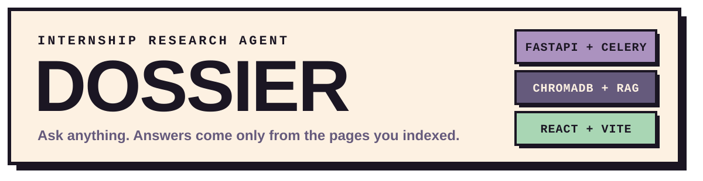
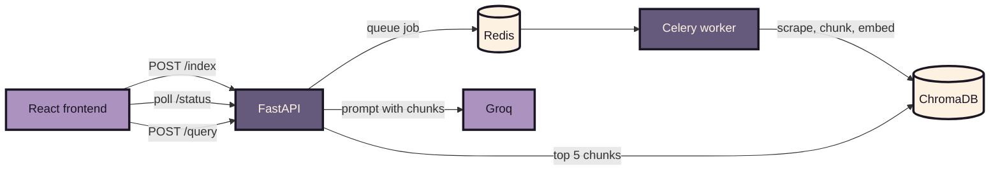
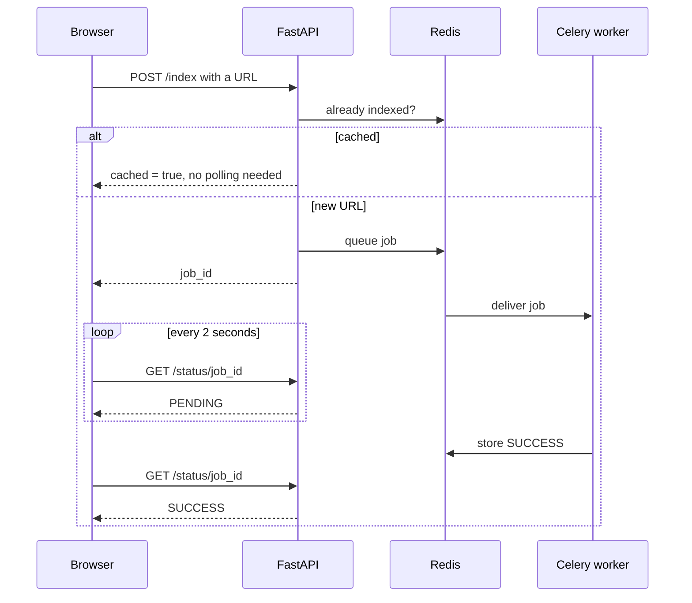

  

  
  
  
  
  
  

  <b>Paste company and internship links. Ask questions. Get answers grounded in the real pages.</b>

## Overview

Dossier is a retrieval-augmented research agent for internship hunting. It indexes the pages you give it, then answers questions using only that content, and says so when the answer is not there.

| Index | Ask | Grounded |
| --- | --- | --- |
| Paste several links at once and watch each one finish live | One conversation per link, with markdown answers and follow-ups | Answers use only the scraped text, or state that they could not find it |

## Architecture

## Indexing flow

## API

| Method | Path | Purpose |
| --- | --- | --- |
| POST | `/scrape` | Fetch a URL and return clean text |
| POST | `/index` | Queue an indexing job, returns `job_id` |
| GET | `/status/{job_id}` | PENDING, SUCCESS, or FAILURE |
| POST | `/query` | Answer a question about an indexed URL |

## License

Copyright © 2026 [Lohori Sinha](https://github.com/lohorisinha). This project is [MIT](https://github.com/lohorisinha/Dossier/blob/main/LICENSE) licensed.